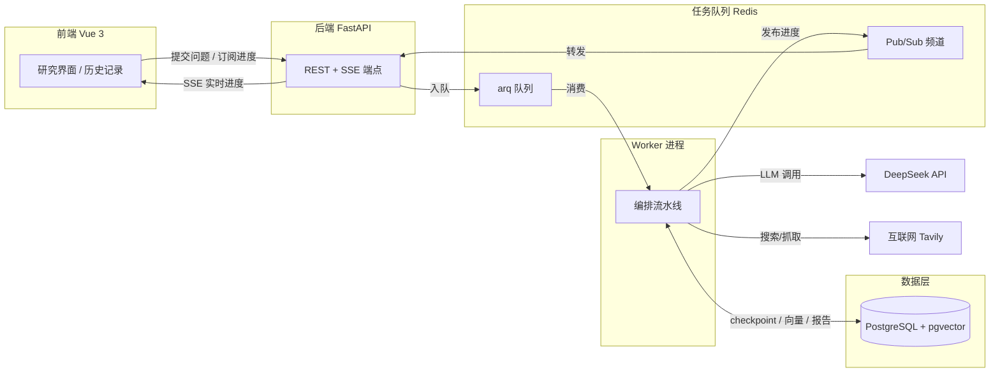
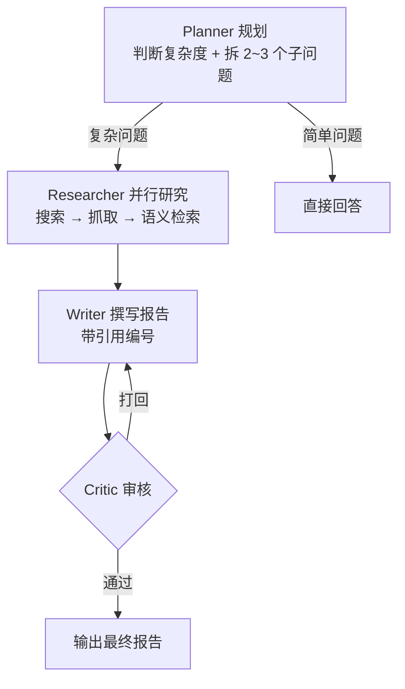

# DeepSearch · 多智能体深度研究 Agent

输入一个问题，自动完成「规划 → 并行检索 → 写作 → 审核」的完整研究流程，产出一份**带引用来源**的结构化研究报告。

基于 DeepSeek 大模型 + RAG（PostgreSQL/pgvector）+ 任务队列（Redis/arq），支持断点恢复、实时进度流、Token 成本控制。

---

## ✨ 核心特性

- **多智能体流水线**：`Planner → 并行 Researcher → Writer ⇄ Critic`，Critic 打回后 Writer 改写，直到通过或达到最大轮数。
- **简单问题快路径**：Planner 判定为事实/定义类问题时直接回答，不搜索、不抓取、不审核，省 Token 省时间。
- **RAG 检索增强**：网页抓取后切片入库（pgvector），用 BGE 中文 embedding 做语义检索，报告每个结论都标注引用编号 `[n]` 并溯源到真实来源。
- **断点恢复**：每个阶段（规划 / 研究 / 写作 / 审核）都写入 checkpoint，中断后从断点续跑，不重做已完成阶段。
- **实时进度流**：worker 通过 Redis pub/sub 发布进度事件，后端转成 SSE 推给前端，规划、研究员、工具调用、审核实时可见。
- **任务队列**：Redis + arq 异步队列，支持多任务并发、失败自动重试、优雅停机、队列状态监控。
- **成本控制**：Token 预算超限自动中止、LLM/工具超时重试、按 Agent 统计 Token/成本/耗时。
- **导出**：研究报告一键导出 Word / PDF。

---

## 🏗 系统架构



## 🔄 研究流水线



---

## 🛠 技术栈与选型

| 层 | 技术 | 选型理由 |
|----|------|----------|
| LLM | DeepSeek（`deepseek-chat`） | OpenAI 兼容协议，httpx 手写调用不依赖 SDK，成本低 |
| 搜索 | Tavily | 面向 Agent 的搜索 API，返回结构化结果 |
| 向量库 | PostgreSQL + pgvector | 复用已有数据库，避免引入独立向量服务 |
| Embedding | fastembed + BGE（`bge-small-zh-v1.5`） | 本地离线推理，零成本；中文效果好，512 维 |
| 任务队列 | Redis + arq | arq 是 asyncio 原生队列，与 FastAPI 技术栈一致 |
| 后端 | FastAPI + uvicorn | 异步高性能，原生支持 SSE |
| 前端 | Vue 3 + Vite | 响应式驱动实时进度，构建快 |
| 导出 | docx / html2pdf.js | 前端直接生成，无需后端渲染 |

---

## 🚀 快速开始

### 方式一：Docker 一键启动（推荐）

```bash
# 1. 配置密钥
cp backend/.env.example backend/.env
# 编辑 backend/.env，填入 DEEPSEEK_API_KEY 和 TAVILY_API_KEY

# 2. 一键启动（db + redis + backend + worker + frontend）
docker compose up -d --build
```

启动后访问 `http://localhost`（前端）、`http://localhost:8000/docs`（API 文档）。

### 方式二：本地开发

```bash
# 1. 启动基础设施
docker compose up -d db redis

# 2. 后端（终端 A）
cd backend
python -m venv .venv && .venv/Scripts/activate   # Windows；Linux 用 source .venv/bin/activate
pip install -r requirements.txt
uvicorn app.main:app --reload

# 3. Worker（终端 B）
cd backend
.venv/Scripts/python -m app.worker

# 4. 前端（终端 C）
cd frontend
npm install
npm run dev
```

前端默认跑在 `http://localhost:5173`（Vite 已配置 `/api` 代理到 8000）。

---

## ⚙️ 配置说明（`backend/.env`）

| 变量 | 说明 |
|------|------|
| `DEEPSEEK_API_KEY` | DeepSeek API 密钥（必填） |
| `TAVILY_API_KEY` | Tavily 搜索密钥（必填） |
| `DB_URL` | PostgreSQL 连接串（默认本机 pgvector） |
| `REDIS_URL` | Redis 连接串 |
| `EMBEDDING_MODEL` / `EMBEDDING_DIM` | BGE 模型与维度（默认 `bge-small-zh-v1.5` / 512） |
| `WORKER_CONCURRENCY` | worker 并发研究任务数（默认 2） |
| `TASK_RETRIES` | 研究失败自动重试次数（默认 1） |
| `TASK_TIMEOUT` | 单任务整体超时（秒，默认 600） |
| `TOOL_TIMEOUT` / `TOOL_RETRIES` | 工具调用超时 / 重试 |
| `LLM_TIMEOUT` / `LLM_RETRIES` | LLM 调用超时 / 重试 |
| `TOKEN_BUDGET` | 单任务 Token 预算上限（默认 20 万） |

---

## 📁 目录结构

```
DeepSearch/
├── backend/
│   └── app/
│       ├── main.py            # FastAPI 入口
│       ├── worker.py          # arq 后台 worker（消费队列、跑流水线）
│       ├── api/tasks.py       # REST + SSE 端点
│       ├── agent/
│       │   ├── orchestrator.py # 流水线编排 + 断点恢复
│       │   ├── loop.py         # 手写 tool-calling 循环
│       │   └── prompts.py      # Planner/Researcher/Writer/Critic 提示词
│       ├── core/
│       │   ├── config.py       # 配置
│       │   ├── llm/            # DeepSeek provider（流式 + 非流式）
│       │   ├── retry.py        # 超时重试
│       │   └── cost.py         # Token 成本计算
│       ├── rag/
│       │   ├── store.py        # pgvector 存储（checkpoint/trace/向量/报告）
│       │   ├── embedding.py    # fastembed BGE 嵌入
│       │   └── chunker.py      # 网页正文分块
│       └── tools/
│           ├── search.py       # Tavily 搜索
│           ├── fetch.py        # 网页抓取入库（含引用编号）
│           └── vector_search.py# 语义检索
├── frontend/
│   └── src/
│       ├── App.vue             # 主界面（研究 + 历史）
│       ├── components/MarkdownView.vue
│       └── lib/                # sse.js（SSE 客户端）、export.js（导出）
└── docker-compose.yml          # db + redis + backend + worker + frontend
```

---

## 💡 几个关键工程决策

### 1. 断点恢复（checkpoint）

每个阶段完成后把中间产物（计划、各子问题发现、草稿、审核轮次、已用 Token）写入 `task_checkpoint` 表。中断后续跑时读取 checkpoint，跳过已完成阶段，**最多重复一次在跑的 LLM 调用**——既保证不丢进度，又避免重复计费。

### 2. 取消与并发的一致性

取消（`POST /tasks/{id}/cancel`）与 worker 是并发的，用**条件更新**保证正确性：
- `start_if_pending`：仅 `pending → running` 才执行，排队中被取消的任务不会被误启动；
- `finish_if_running`：仅 `running → done/failed` 才落终态，取消后的任务不会被覆盖回完成态。

### 3. 实时进度（Redis pub/sub + SSE）

worker 把每个进度事件 `PUBLISH` 到 `task:{id}` 频道，后端 SSE 端点先补发一份**快照**（让晚连入的客户端重建当前进度），再订阅频道转发增量事件。前端 SSE 断线时自动降级回轮询兜底。

### 4. 任务队列（arq）

`POST /research` 只做「建任务 + 入队」，立即返回；worker 异步消费。支持并发（`max_jobs`）、失败自动重试（从 checkpoint 断点继续）、优雅停机（`stop_grace_period`）、启动时清理卡住的僵尸任务。

---

## 📝 示例

```
输入：比较向量数据库与传统关系型数据库在语义检索方面的优劣

输出（节选）：
# 向量数据库 vs. 传统关系型数据库：语义检索能力比较报告

## 一、结论摘要
...（每个关键结论句尾标注 [1]、[2]）

## 参考来源
[1] 《向量数据库技术综述》 — https://...
[2] ...
```

---

## 📄 License

MIT
